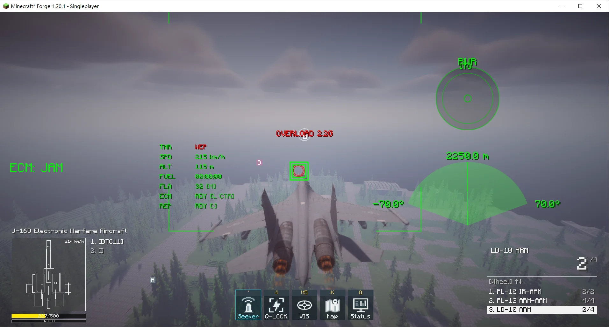
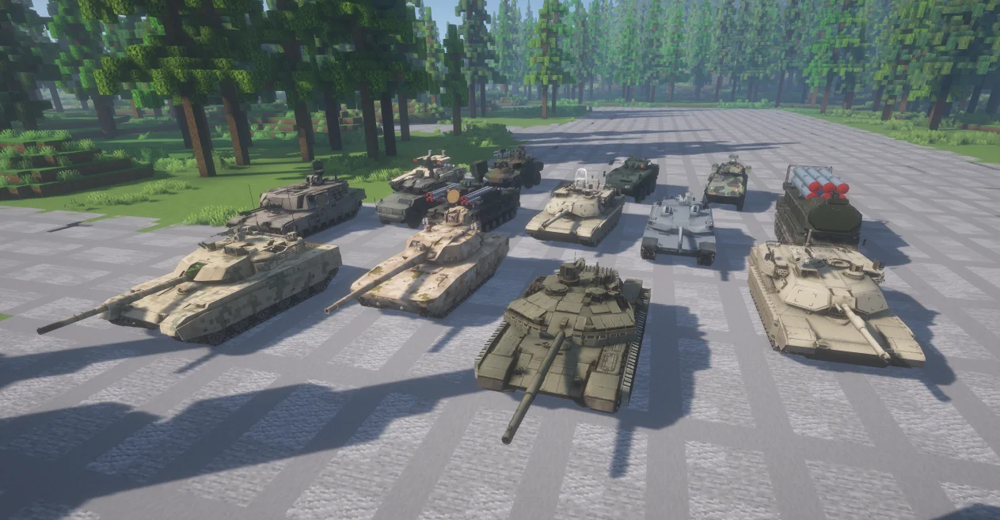
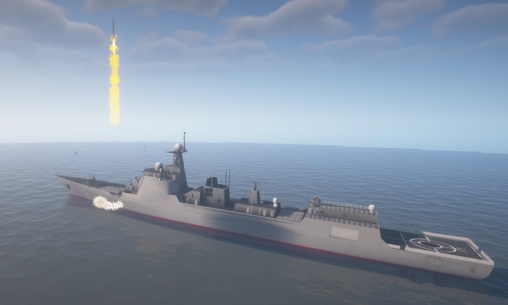

## 画廊

  <figure><figcaption>人在回路 TV 导弹</figcaption></figure>
  <figure><figcaption>反辐射导弹</figcaption></figure>
  <figure><figcaption>地面载具</figcaption></figure>
  <figure><figcaption>武装直升机</figcaption></figure>
  <figure><figcaption>战斗机</figcaption></figure>
  <figure><figcaption>驱逐舰编队</figcaption></figure>
  <figure><figcaption>舰载导弹发射</figcaption></figure>

---

## Wiki 目录

| 页面 | 内容 |
| --- | --- |
| [武器系统](wiki/weapons.html) | 枪炮弹药、火箭弹、导弹、航空炸弹、鱼雷、吊舱、激光武器、火力支援与武器改装 |
| [辅助设备](wiki/equipment.html) | ERA、APS、ECM、光电干扰机、DIRCM、干扰弹与维修设备 |
| [模块化损伤](wiki/damage.html) | 部位与模块耐久、失效效果、伤害计算与维修顺序 |
| [车载无人机](wiki/uav.html) | 可部署无人机、无人战车、96L6 雷达车与舰载直升机着舰 |
| [战术地图](wiki/tactical-map.html) | GPS 装订、雷达目标列表、炮兵地图与小型炮兵地图 |
| [界面与操作](wiki/interface.html) | 人在回路 HUD、头瞄、焦点锁定、告警与 CCIP |
| [AI 乘员](wiki/ai-crew.html) | 炮手生成器、行为配置、驾驶与自动反制 |
| [载具](wiki/vehicles.html) | 39 台可操控载具的分类与说明 |
| [配置、兼容与许可](wiki/config.html) | 配置文件、性能建议、兼容性、许可与致谢 |

---

## 快速开始

1. 安装 Minecraft 1.20.1 + Forge 47.4.x。
2. 将 `ywzj_vehicle-1.20.1-0.6.2.1.jar` 与 `ywzj_rvp-1.20.1-1.0.0_preview_0.6.2.1-full.jar` 放入 `mods/`。
3. 启动一次客户端或服务端，等待载具包释放到 `limitless_vehicle/rvp/`。
4. 进入游戏，在创造模式物品栏确认 RVP 载具与物品已出现。

完整下载、安装要求与反馈方式见 [Release 页面](https://github.com/TV90/limitless-vehicle-rvp-addon/releases/tag/1.0.0_preview_0.6.2.1)。

---

## English

**RVP (Real Vehicle Pack)** is a large add-on for **Limitless Vehicle** on Minecraft 1.20.1 / Forge. It adds weapons, ammunition types, support equipment, and gameplay systems on top of the LV vehicle framework. Signature features include anti-radiation missiles, man-in-the-loop missiles, and extensive ammunition customization.

See [README_EN.md](https://github.com/TV90/limitless-vehicle-rvp-addon/blob/master/README_EN.md) for the English overview, or open the [English Wiki](en/index.html).

---

## 开发文档

开发与配置文档见 [docs/README.md](https://github.com/TV90/limitless-vehicle-rvp-addon/blob/master/docs/README.md)。
